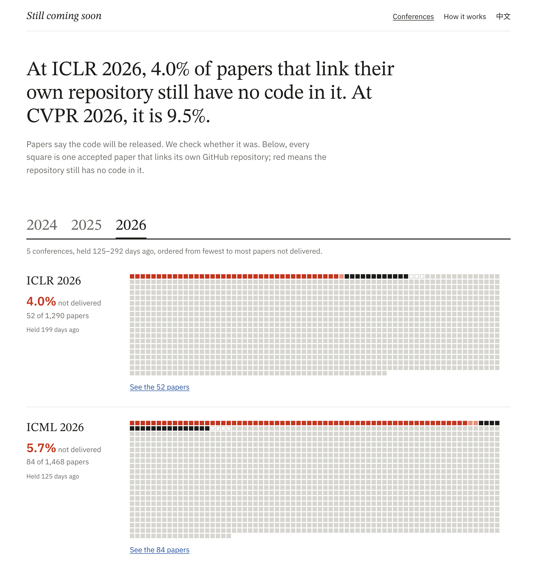
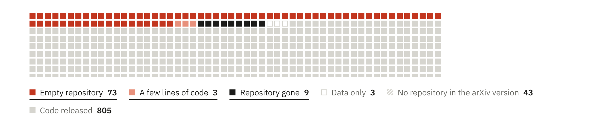
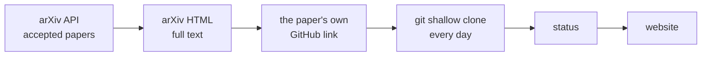

<h1 align="center">Still coming soon</h1>

<p align="center">
  <b>Papers say “code will be released.” We check whether it was.</b><br>
  Every accepted paper at 11 major AI conferences that links its own GitHub repository, checked again every day.
</p>

<p align="center">
  <a href="https://calvin1989.github.io/still-coming-soon/"><b>Website</b></a> ·
  <a href="https://calvin1989.github.io/still-coming-soon/about.html">How it works</a> ·
  <a href="#are-you-an-author">For authors</a> ·
  <a href="#the-data">Data</a> ·
  <a href="README.zh-CN.md">简体中文</a>
</p>

<p align="center">
  <a href="https://github.com/Calvin1989/still-coming-soon/actions/workflows/daily.yml"></a>
  <a href="https://github.com/Calvin1989/still-coming-soon/commits/main"></a>
  <a href="https://github.com/Calvin1989/still-coming-soon/actions/workflows/test.yml"></a>
  <a href="LICENSE"></a>
</p>

<p align="center">
  <a href="https://calvin1989.github.io/still-coming-soon/"></a>
</p>

## What we found

We found **30,507 accepted papers** on arXiv from 25 editions of NeurIPS, ICLR, ICML, CVPR, ICCV, ECCV, ACL, EMNLP, AAAI, IJCAI and ACM MM (2024–2026). **17,139** of them link a GitHub repository as their own.

- **1,079 of those repositories still have no code.** They are empty, hold a few lines, or no longer exist. 703 of them have been waiting for more than a year.
- **Waiting longer does not help.** Conferences held two years ago are at 6.0%, last year's at 6.4%, this year's at 6.5%. Code that is not there a few months after the conference rarely shows up later.
- **Most of these papers never said “coming soon”.** Only 115 of the 1,079 say the code *will be* released. The rest print the link as the place where the code is.
- **Conferences differ a lot.** NeurIPS, ICLR and ICML stay between 3% and 6%. ECCV, EMNLP, AAAI, IJCAI and ACM MM reach 9% to 13%.

Share of papers whose own repository still has no code, as of 2026-11-08:

| | 2024 | 2025 | 2026 |
|---|---:|---:|---:|
| NeurIPS | 3.4% | 4.0% | from Mar 6 |
| ICLR | 3.4% | 3.8% | 4.0% |
| ICML | 3.6% | 3.6% | 5.7% |
| CVPR | 5.5% | 7.5% | 9.5% |
| ICCV | – | 8.2% | – |
| ECCV | 9.9% | – | from Dec 7 |
| ACL | 8.7% | 7.7% | 7.0% |
| EMNLP | 9.3% | 10.3% | from Jan 22 |
| AAAI | 6.6% | 10.6% | 9.2% |
| IJCAI | 6.4% | 11.9% | from Nov 13 |
| ACM MM | 13.2% | 10.5% | from Feb 8 |
| **All** | **6.0%** | **6.4%** | **6.5%** |

Conferences appear on the site 90 days after they open, so authors have time to tidy up. The [website](https://calvin1989.github.io/still-coming-soon/) has the live numbers and every paper behind them.

<details>
<summary>All 25 conferences in detail</summary>

| Conference | Accepted papers on arXiv | With their own repository | Empty | A few lines | Gone | Not delivered |
|---|---:|---:|---:|---:|---:|---:|
| ICLR 2026 | 2,085 | 1,290 | 39 | 1 | 12 | 52 (4.0%) |
| ICML 2026 | 2,577 | 1,468 | 63 | 2 | 19 | 84 (5.7%) |
| ACL 2026 | 1,045 | 683 | 35 | 1 | 12 | 48 (7.0%) |
| AAAI 2026 | 1,563 | 444 | 28 | 1 | 12 | 41 (9.2%) |
| CVPR 2026 | 1,926 | 893 | 73 | 3 | 9 | 85 (9.5%) |
| ICML 2025 | 1,319 | 784 | 20 | 1 | 7 | 28 (3.6%) |
| ICLR 2025 | 1,626 | 1,022 | 23 | 5 | 11 | 39 (3.8%) |
| NeurIPS 2025 | 2,345 | 1,410 | 39 | 1 | 16 | 56 (4.0%) |
| CVPR 2025 | 1,393 | 655 | 37 | 6 | 6 | 49 (7.5%) |
| ACL 2025 | 946 | 613 | 38 | 3 | 6 | 47 (7.7%) |
| ICCV 2025 | 1,198 | 597 | 39 | 1 | 9 | 49 (8.2%) |
| EMNLP 2025 | 926 | 610 | 50 | 4 | 9 | 63 (10.3%) |
| ACM MM 2025 | 292 | 153 | 13 | 0 | 3 | 16 (10.5%) |
| AAAI 2025 | 1,205 | 481 | 36 | 6 | 9 | 51 (10.6%) |
| IJCAI 2025 | 297 | 143 | 12 | 1 | 4 | 17 (11.9%) |
| ICLR 2024 | 1,071 | 679 | 13 | 2 | 8 | 23 (3.4%) |
| NeurIPS 2024 | 2,000 | 1,294 | 35 | 3 | 6 | 44 (3.4%) |
| ICML 2024 | 1,131 | 686 | 18 | 0 | 7 | 25 (3.6%) |
| CVPR 2024 | 1,417 | 742 | 28 | 4 | 9 | 41 (5.5%) |
| IJCAI 2024 | 282 | 141 | 8 | 0 | 1 | 9 (6.4%) |
| AAAI 2024 | 977 | 518 | 21 | 2 | 11 | 34 (6.6%) |
| ACL 2024 | 631 | 469 | 27 | 3 | 11 | 41 (8.7%) |
| EMNLP 2024 | 719 | 497 | 32 | 5 | 9 | 46 (9.3%) |
| ECCV 2024 | 1,293 | 716 | 63 | 2 | 6 | 71 (9.9%) |
| ACM MM 2024 | 243 | 151 | 13 | 2 | 5 | 20 (13.2%) |

</details>

## What counts as “not delivered”

<p align="center"></p>

| Status | Rule | Counted as not delivered |
|---|---|:---:|
| Empty repository | Only a README, a license or images | ✔ |
| A few lines of code | Some source files, under 5 KB in total | ✔ |
| Repository gone | The repository does not exist or is private | ✔ |
| Data only | No source files, but ≥ 100 KB of data or model files | |
| Code released | Source files add up to ≥ 5 KB | |

Papers with only an anonymous review link, or with a promise but no link, are listed on the site but not counted.

As extra information, the site also marks released repositories whose README checklist (“- [ ] Release training code”) still has unticked release items. These are never counted as not delivered. Only clear promises of training code, weights, data or inference code count, and an item is treated as done when the repository has matching files or the README links a download.

We would rather miss a case than accuse someone wrongly:

- **Only the paper's own repository counts.** That is a link in the abstract or the title block, or one the paper presents as its code (“Our code is available at …”). Links in the references, and code the paper merely builds on, never count.
- **If the paper gives two spellings of a link, either one with code is enough.** Abstracts and full texts sometimes disagree, and accounts get renamed.
- **Every “repository gone” entry was read by hand** after each conference's first run. Each extraction error we found became a test case.

All thresholds are in [`pipeline/config.toml`](pipeline/config.toml). The full rules are on the [How it works](https://calvin1989.github.io/still-coming-soon/about.html) page.

## Are you an author?

- **Pushed your code?** You don't need to do anything. The next daily check (02:17 UTC) picks it up and the site updates.
- **Your code is somewhere else?** If it is on another branch, on Hugging Face, or in a different repository than the one we found, please [tell us](https://github.com/Calvin1989/still-coming-soon/issues/new?template=wrong-entry.yml) and we will fix the entry.

The site shows no author names. A repository can be empty for good reasons; the point is the overall picture, not any single paper.

## The data

Everything is in [`data/`](data/) as JSON Lines and committed daily, so the git history is the record of every check.

| Path | What it holds |
|---|---|
| `data/papers/<venue>.jsonl` | Accepted papers found on arXiv |
| `data/fulltext/<venue>.jsonl` | Paragraphs of each paper that contain links or promises |
| `data/links/<venue>.jsonl` | The repository each paper calls its own, with the sentence it appears in |
| `data/snapshots/<venue>.jsonl` | The result of the latest check of each repository |
| `data/schedule.json` | Conference dates picked up automatically |

## How it works



1. **Papers** (monthly). Search arXiv for papers whose comment says they were accepted at the conference, for example `Accepted at ICLR 2025`. Workshop papers and papers “under review” are excluded.
2. **Full text** (monthly). Read the arXiv HTML version. Its structure tells the abstract, footnotes and references apart.
3. **The paper's own repository** (daily). Pick the link by where it appears and what its sentence says.
4. **Check** (daily). Run `git clone --depth 1` without checkout and list the files in the latest commit. This uses no GitHub API quota.
5. **Website** (daily). Build static pages and deploy them to GitHub Pages.

New conferences are added by themselves. Every day the pipeline reads conference dates from [ccfddl/ccf-deadlines](https://github.com/ccfddl/ccf-deadlines). When a new edition is announced, it copies last year's settings with the year changed.

## Run it yourself

Python 3.11+ (standard library only) and `git`.

```bash
cd pipeline
python -m scs papers   --venue iclr2025   # arXiv API → data/papers/
python -m scs fulltext --venue iclr2025   # arXiv HTML → data/fulltext/ (3 s per paper)
python -m scs links    --venue iclr2025   # → data/links/
python -m scs probe    --venue iclr2025   # git clone → data/snapshots/
python -m scs build    --venue iclr2025   # → data/site/
python -m scs render                      # → public/
```

Each step reads the files of the previous one and can be re-run on its own. Tests need no network: `pip install pytest ruff && ruff check . && pytest`.

To track another conference, add a `[venues.<key>]` section to `pipeline/config.toml` with its arXiv query and date. Add its ccfddl file under `[auto]` and later years will follow on their own. Design notes, in Chinese, are in [DESIGN.md](DESIGN.md).

## FAQ

<details>
<summary><b>Isn't this naming and shaming?</b></summary>

The site shows no author names, and each entry only quotes what the paper itself says next to what the repository holds. The interesting part is the aggregate: how often “code is available” turns out not to be true, and how that differs between communities. An author can fix an entry by pushing the code.
</details>

<details>
<summary><b>Why only arXiv?</b></summary>

arXiv has an open API and a structured HTML version of each paper. OpenReview blocks automated access, and the proceedings sites have no full-text API. So the numbers describe accepted papers that are on arXiv, which is most of them at these conferences.
</details>

<details>
<summary><b>Does “code released” mean the code works?</b></summary>

No. It only means the repository holds at least 5 KB of source files. Whether the code runs or reproduces the paper is a different and harder question. Our numbers are a lower bound.
</details>

<details>
<summary><b>Why wait 90 days?</b></summary>

Many authors clean up their code around the conference. Flagging a repository the week the conference opens would be unfair, so each conference appears on the site 90 days after it opens. The site lists the date each upcoming conference will appear.
</details>

## Citation

```bibtex
@misc{stillcomingsoon2026,
  title        = {Still Coming Soon: Checking Whether ``Code Will Be Released'' Comes True},
  author       = {Calvin},
  year         = {2026},
  howpublished = {\url{https://github.com/Calvin1989/still-coming-soon}}
}
```

## License

Code: [MIT](LICENSE). Paper metadata comes from arXiv; repository contents belong to their authors.
