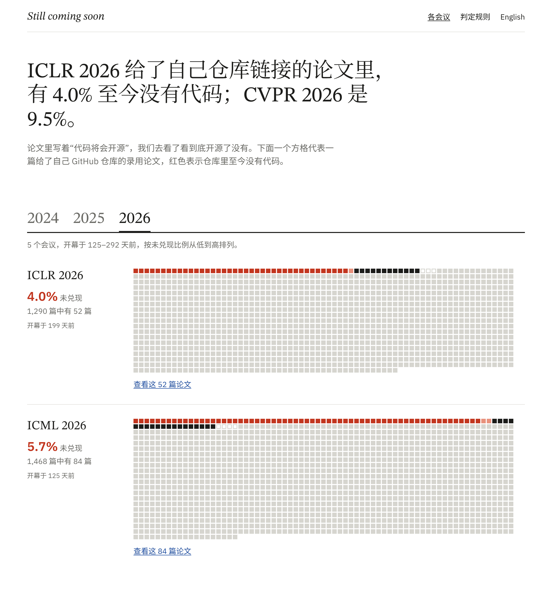
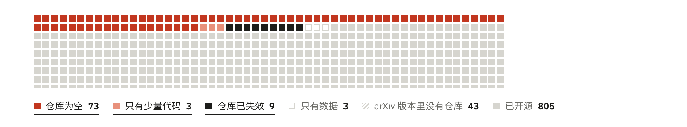
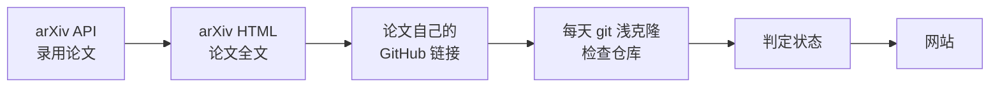

<h1 align="center">Still coming soon</h1>

<p align="center">
  <b>论文里写着“代码将会开源”，我们每天去看它开源了没有。</b><br>
  11 个 AI 顶会的录用论文，只要给了自己的 GitHub 仓库，就每天检查一遍。
</p>

<p align="center">
  <a href="https://calvin1989.github.io/still-coming-soon/zh/"><b>网站</b></a> ·
  <a href="https://calvin1989.github.io/still-coming-soon/zh/about.html">判定规则</a> ·
  <a href="#如果你是论文作者">作者看这里</a> ·
  <a href="#数据">数据</a> ·
  <a href="README.md">English</a>
</p>

<p align="center">
  <a href="https://github.com/Calvin1989/still-coming-soon/actions/workflows/daily.yml"></a>
  <a href="https://github.com/Calvin1989/still-coming-soon/commits/main"></a>
  <a href="https://github.com/Calvin1989/still-coming-soon/actions/workflows/test.yml"></a>
  <a href="LICENSE"></a>
</p>

<p align="center">
  <a href="https://calvin1989.github.io/still-coming-soon/zh/"></a>
</p>

## 发现了什么

我们在 arXiv 上找到了 NeurIPS、ICLR、ICML、CVPR、ICCV、ECCV、ACL、EMNLP、AAAI、IJCAI、ACM MM 在 2024–2026 年共 25 届会议的 **30,507 篇录用论文**，其中 **17,139 篇**给了自己的 GitHub 仓库。

- **1,079 个仓库至今没有代码**：要么是空的，要么只有几行，要么已经删了。其中 703 个已经等了一年以上。
- **再等也不会有。** 两年前的会议未兑现 6.0%，去年的 6.4%，今年的 6.5%。会后几个月还没放出来的代码，之后基本也不会放了。
- **大多数论文没说“即将开源”。** 这 1,079 篇里只有 115 篇写的是“代码将会公开”，其余的都把链接写成了代码所在的位置。
- **各会议差别很大。** NeurIPS、ICLR、ICML 一直在 3%–6%；ECCV、EMNLP、AAAI、IJCAI、ACM MM 最高到 9%–13%。

给了自己仓库、但仓库里至今没有代码的比例（2026-11-08）：

| 会议 | 2024 | 2025 | 2026 |
|---|---:|---:|---:|
| NeurIPS | 3.4% | 4.0% | 3 月 6 日上线 |
| ICLR | 3.4% | 3.8% | 4.0% |
| ICML | 3.6% | 3.6% | 5.7% |
| CVPR | 5.5% | 7.5% | 9.5% |
| ICCV | – | 8.2% | – |
| ECCV | 9.9% | – | 12 月 7 日上线 |
| ACL | 8.7% | 7.7% | 7.0% |
| EMNLP | 9.3% | 10.3% | 1 月 22 日上线 |
| AAAI | 6.6% | 10.6% | 9.2% |
| IJCAI | 6.4% | 11.9% | 11 月 13 日上线 |
| ACM MM | 13.2% | 10.5% | 2 月 8 日上线 |
| **合计** | **6.0%** | **6.4%** | **6.5%** |

每个会议开幕 90 天后才上线，给作者留出整理代码的时间。[网站](https://calvin1989.github.io/still-coming-soon/zh/)上是每天更新的数字，以及背后的每一篇论文。

<details>
<summary>25 届会议的详细数字</summary>

| 会议 | arXiv 上的录用论文 | 给了自己仓库 | 仓库为空 | 只有少量代码 | 仓库已失效 | 未兑现 |
|---|---:|---:|---:|---:|---:|---:|
| ICLR 2026 | 2,085 | 1,290 | 39 | 1 | 12 | 52 (4.0%) |
| ICML 2026 | 2,577 | 1,468 | 63 | 2 | 19 | 84 (5.7%) |
| ACL 2026 | 1,045 | 683 | 35 | 1 | 12 | 48 (7.0%) |
| AAAI 2026 | 1,563 | 444 | 28 | 1 | 12 | 41 (9.2%) |
| CVPR 2026 | 1,926 | 893 | 73 | 3 | 9 | 85 (9.5%) |
| ICML 2025 | 1,319 | 784 | 20 | 1 | 7 | 28 (3.6%) |
| ICLR 2025 | 1,626 | 1,022 | 23 | 5 | 11 | 39 (3.8%) |
| NeurIPS 2025 | 2,345 | 1,410 | 39 | 1 | 16 | 56 (4.0%) |
| CVPR 2025 | 1,393 | 655 | 37 | 6 | 6 | 49 (7.5%) |
| ACL 2025 | 946 | 613 | 38 | 3 | 6 | 47 (7.7%) |
| ICCV 2025 | 1,198 | 597 | 39 | 1 | 9 | 49 (8.2%) |
| EMNLP 2025 | 926 | 610 | 50 | 4 | 9 | 63 (10.3%) |
| ACM MM 2025 | 292 | 153 | 13 | 0 | 3 | 16 (10.5%) |
| AAAI 2025 | 1,205 | 481 | 36 | 6 | 9 | 51 (10.6%) |
| IJCAI 2025 | 297 | 143 | 12 | 1 | 4 | 17 (11.9%) |
| ICLR 2024 | 1,071 | 679 | 13 | 2 | 8 | 23 (3.4%) |
| NeurIPS 2024 | 2,000 | 1,294 | 35 | 3 | 6 | 44 (3.4%) |
| ICML 2024 | 1,131 | 686 | 18 | 0 | 7 | 25 (3.6%) |
| CVPR 2024 | 1,417 | 742 | 28 | 4 | 9 | 41 (5.5%) |
| IJCAI 2024 | 282 | 141 | 8 | 0 | 1 | 9 (6.4%) |
| AAAI 2024 | 977 | 518 | 21 | 2 | 11 | 34 (6.6%) |
| ACL 2024 | 631 | 469 | 27 | 3 | 11 | 41 (8.7%) |
| EMNLP 2024 | 719 | 497 | 32 | 5 | 9 | 46 (9.3%) |
| ECCV 2024 | 1,293 | 716 | 63 | 2 | 6 | 71 (9.9%) |
| ACM MM 2024 | 243 | 151 | 13 | 2 | 5 | 20 (13.2%) |

</details>

## 怎样算“没兑现”

<p align="center"></p>

| 状态 | 判定 | 算没兑现 |
|---|---|:---:|
| 仓库为空 | 只有 README、许可证或图片 | ✔ |
| 只有少量代码 | 有源代码，但加起来不到 5 KB | ✔ |
| 仓库已失效 | 仓库不存在或已设为私有 | ✔ |
| 只有数据 | 没有源代码，但有 100 KB 以上的数据或模型文件 | |
| 已开源 | 源代码加起来不少于 5 KB | |

定稿里还是匿名评审链接、或者只说会开源却没给链接的论文，网站上会列出来，但不计入比例。

另外，网站会把“已开源，但作者 README 清单（“- [ ] Release training code”）还没勾完”的论文单独标出来，作为补充信息，不计入比例。只算训练代码、模型权重、数据、推理代码这几类明确的发布承诺；仓库里已经有对应文件、或者 README 里有下载链接的，当作已经放了。

我们的原则是宁可漏判，不冤枉作者：

- **只看论文自己的仓库。** 也就是摘要或作者信息里的链接，或者论文明确说是自己代码的链接（“Our code is available at …”）。参考文献里的链接、论文只是用到的别人的代码，一律不算。
- **论文给了两种写法的链接，任何一个有代码都算兑现。** 摘要和正文的链接有时不一致，作者账号也可能改过名。
- **每个“仓库已失效”都人工核对过。** 每个会议第一次跑完后都逐条看过，发现的提取错误都写成了测试用例。

所有阈值都在 [`pipeline/config.toml`](pipeline/config.toml) 里，完整规则见网站的[判定规则](https://calvin1989.github.io/still-coming-soon/zh/about.html)。

## 如果你是论文作者

- **已经上传了代码？** 什么都不用做。下一次每日检查（北京时间 10:17 左右）会发现，网站随之更新。
- **代码在别的地方？** 比如在其他分支、Hugging Face，或者我们找错了仓库，请[告诉我们](https://github.com/Calvin1989/still-coming-soon/issues/new?template=wrong-entry.yml)，我们会修正。

网站不显示作者姓名。仓库为空可能有各种正当原因，我们关心的是整体情况，不是某一篇论文。

## 数据

所有数据都在 [`data/`](data/) 里，格式是 JSON Lines，每天提交一次，git 历史就是每次检查的记录。

| 路径 | 内容 |
|---|---|
| `data/papers/<venue>.jsonl` | 在 arXiv 上找到的录用论文 |
| `data/fulltext/<venue>.jsonl` | 每篇论文里含链接或承诺的段落 |
| `data/links/<venue>.jsonl` | 每篇论文自己的仓库，以及给出链接的那句话 |
| `data/snapshots/<venue>.jsonl` | 每个仓库最近一次的检查结果 |
| `data/schedule.json` | 自动获取的会议日期 |

## 工作原理



1. **找论文**（每月）：在 arXiv 上搜备注里写了被会议录用的论文，比如 `Accepted at ICLR 2025`。workshop 论文和“under review”的论文会被排除。
2. **读全文**（每月）：读 arXiv 的 HTML 版，靠它的结构区分摘要、脚注和参考文献。
3. **找自己的仓库**（每天）：根据链接出现的位置和所在的句子判断。
4. **检查仓库**（每天）：`git clone --depth 1` 不检出文件，只列出最新一次提交里的文件，不消耗 GitHub API 配额。
5. **生成网站**（每天）：生成静态页面，部署到 GitHub Pages。

新会议会自动加入：每天从 [ccfddl/ccf-deadlines](https://github.com/ccfddl/ccf-deadlines) 读取会议日期，某个会议公布新一届的日期后，就照着上一届的设置改年份加进来。

## 自己运行

需要 Python 3.11+（只用标准库）和 `git`。

```bash
cd pipeline
python -m scs papers   --venue iclr2025   # arXiv API → data/papers/
python -m scs fulltext --venue iclr2025   # arXiv HTML → data/fulltext/（每篇间隔 3 秒）
python -m scs links    --venue iclr2025   # → data/links/
python -m scs probe    --venue iclr2025   # git clone → data/snapshots/
python -m scs build    --venue iclr2025   # → data/site/
python -m scs render                      # → public/
```

每一步只读上一步的文件，可以单独重跑。测试不需要联网：`pip install pytest ruff && ruff check . && pytest`。

想跟踪别的会议，在 `pipeline/config.toml` 里加一段 `[venues.<key>]`，写上 arXiv 检索词和会议日期；再在 `[auto]` 里写上它在 ccfddl 里的文件，以后每年就会自动加入。设计记录见 [DESIGN.md](DESIGN.md)。

## 常见问题

<details>
<summary><b>这不是在点名批评吗？</b></summary>

网站不显示作者姓名，每一条只是把论文自己写的话和仓库里实际有的东西并排放着。真正有意义的是整体：“代码已公开”有多少时候并不成立，不同领域之间差多少。作者只要上传代码，第二天这一条就会变成“已开源”。
</details>

<details>
<summary><b>为什么只看 arXiv？</b></summary>

arXiv 有公开的 API，每篇论文还有结构化的 HTML 版。OpenReview 会拦截自动访问，会议论文集网站也没有全文接口。所以这里的数字是“在 arXiv 上的录用论文”，在这些会议里占了大多数。
</details>

<details>
<summary><b>“已开源”是说代码能跑吗？</b></summary>

不是，只说明仓库里至少有 5 KB 源代码。代码能不能跑、能不能复现论文，是另一个更难的问题。所以我们的数字只是下限。
</details>

<details>
<summary><b>为什么要等 90 天？</b></summary>

很多作者是在会议前后才整理代码的。会议刚开就把仓库标成没兑现不公平，所以每个会议开幕 90 天后才上线，网站上会写明每个待上线会议的日期。
</details>

## 引用

```bibtex
@misc{stillcomingsoon2026,
  title        = {Still Coming Soon: Checking Whether ``Code Will Be Released'' Comes True},
  author       = {Calvin},
  year         = {2026},
  howpublished = {\url{https://github.com/Calvin1989/still-coming-soon}}
}
```

## 许可证

代码采用 [MIT](LICENSE) 许可证。论文元数据来自 arXiv，仓库内容归各自作者所有。
